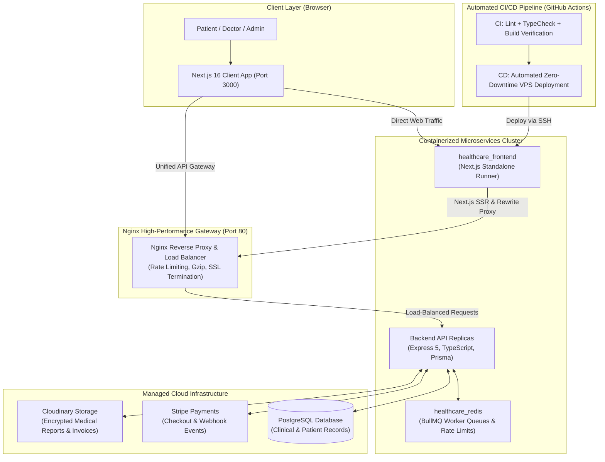

# 🏥 HealthCare — Enterprise Telehealth & Clinical Consultation Platform

<p align="center">
  
  
  
  
  
  
  
  
</p>

---

## 📌 Executive Summary

**HealthCare** is an enterprise-grade digital health and clinical consultation web platform designed to support millions of patients, board-certified doctors, and hospital administrators. Built with **Next.js 16 (App Router)** and **React 19**, the platform unites specialist discovery, real-time schedule locking, dual-track payment systems (Stripe + Automated Pay Later with live expiration countdown), secure Cloudinary PDF invoice delivery, and end-to-end encrypted telehealth records.

Engineered with high-availability cloud standards, the frontend features **Next.js Standalone Containerization** (reducing image size down to **87 MB**), a unified **Nginx Single Gateway Reverse Proxy**, full **GitHub Actions CI/CD Automation**, and dedicated **Admin Observability & BullMQ Queue Monitoring**.

---

## 🏗️ System Architecture & Data Flow



---

## 🚀 Automated CI/CD Pipeline (GitHub Actions)

The repository implements a robust, continuous integration and continuous deployment (CI/CD) lifecycle configured via **GitHub Actions**:

### 1. Continuous Integration (`.github/workflows/ci.yml`)
- **Triggers:** Every push to `main`, `dev`, or `feature/**` branches, and on Pull Requests targeting `main` or `dev`.
- **Concurrency Control:** Cancels superseded in-progress builds to conserve runner compute minutes.
- **Automated Quality Checks:**
  1. **Clean Installation:** `npm ci --legacy-peer-deps` using automated Node.js v20 npm caching.
  2. **ESLint Code Quality Audit:** Validates clean syntax, React Compiler standards, and Next.js best practices (`npm run lint`).
  3. **Strict Type-Checking:** Runs `npx tsc --noEmit` across all 48 App Router routes and modules to prevent runtime type errors.
  4. **Standalone Production Build Verification:** Executes `npm run build` with mock gateway variables to guarantee zero build breakages.

### 2. Continuous Deployment (`.github/workflows/deploy.yml`)
- **Triggers:** Automatically on push to `main` branch (or manual dispatch).
- **Execution Workflow:**
  1. Secure authentication via encrypted SSH (`appleboy/ssh-action@v1.0.3`) into the production Linux VPS.
  2. Executes repository sync (`git pull origin main`).
  3. Rebuilds and launches the Next.js standalone container (`docker compose up -d --build --remove-orphans`).
  4. Automatic garbage collection of dangling layers (`docker image prune -f`) to maintain lean server storage.

---

## ✨ Core Features & Architectural Highlights

### 1. 🌟 High-Conversion Clinical Landing Page
- **Interactive Specialist Search Bar:** Embedded search with real-time specialty filtering and auto-suggestion directly linked to `/doctors`.
- **Dynamic Clinical Departments:** Dynamic data-fetching of medical departments (Cardiology, Neurology, Pediatrics, Orthopedics, Ophthalmology, etc.).
- **Live Doctor Showcase:** Server-rendered doctor cards featuring verified credentials, designation, hospital affiliation, consultation fee, and direct booking CTA.
- **Modern Bento Grid Ecosystem:** Showcases encrypted video telemedicine, cloud e-prescriptions, Stripe checkout, and zero-conflict schedule locking.

### 2. 📅 Zero-Conflict Doctor Scheduling & Booking Engine
- **Slot Reservation Algorithm:** Transactional slot locking prevents double booking and schedule collision.
- **Timezone & Running Date Normalization:** Automatically filters out historical/passed schedule slots to reduce client-side payload and eliminate database load.
- **Smart Appointment Tracking:** Immediate feedback with full booking review modal, doctor summary, and calendar integration.

### 3. 💳 Intelligent Dual-Payment Architecture
- **Stripe Card Checkout:** Seamless integration with Stripe hosted checkout and asynchronous webhook event synchronization.
- **Automated Pay-Later Reservation with Real-Time Expiry:**
  - Patients can reserve their slot instantly without immediate payment.
  - **30-Minute Live Countdown Component (`PayLaterCountdown.tsx`):** Displays real-time remaining minutes and seconds.
  - **Urgent 5-Minute Warning State:** At $\le 5$ minutes, switches into an animated pulsing alert beacon (`⚠️ Hurry! Pay before auto-cancel`).
  - **Auto-Expiration Protection:** Expired bookings automatically deactivate the "Pay Online" button to avoid conflict and keep slot availability clean.
- **Official PDF Invoice Delivery:** Generates PDF invoices stored securely in Cloudinary with dedicated delivery permissions and browser preview.

### 4. 🛡️ Admin Telemetry & Real-Time Monitoring Ecosystem
- **Request Logs & HTTP Telemetry (`/admin/dashboard/request-logs`):**
  - High-throughput audit buffer tracking request path, HTTP method badge, response status codes, latencies, IP addresses, and user-agent devices.
  - Role-based user tracking: Displays authenticated user role badges (`SUPER_ADMIN`, `ADMIN`) and user IDs alongside anonymous public traffic.
  - Fast search, method/status code filtering, and instant audit log cleanup.
- **Background Job Queues Dashboard (`/admin/dashboard/queues`):**
  - Embedded **BullMQ & Bull-Board** visual monitoring dashboard.
  - Real-time visibility into active workers: Email Notification Queue, Stripe Webhook Processing, and Schedule Auto-Release Cron.
  - Same-origin reverse proxy (`next.config.ts` rewrites) eliminating CORS and `X-Frame-Options: SAMEORIGIN` restrictions while automatically relaying authorization cookies.

### 5. 📊 Patient & Doctor Clinical Portals
- **Server-Side Pagination (`AppPagination.tsx`):** Fast URL-driven search parameter pagination (`?page=1&limit=6`) with total records metadata counters.
- **Appointments Management:** Distinct status badges for `SCHEDULED`, `COMPLETED`, and `CANCELED` consultations.
- **Digital Health Records & Prescriptions:** Direct access to medical records, prescriptions, and official receipts.

### 6. 🔐 Role-Based Access Control (RBAC) & Next.js Middleware
- Strict multi-role protection (`PATIENT`, `DOCTOR`, `ADMIN`, `SUPER_ADMIN`).
- Next.js edge middleware inspecting HttpOnly JWT tokens, silent refresh-token rotation, and instant unauthenticated redirects.

---

## 🐳 DevOps, Docker & Containerization

The project utilizes a 4-stage multi-stage Docker build optimized for high-security enterprise environments:

| Stage | Image | Purpose |
| :--- | :--- | :--- |
| **1. Base** | `node:22-alpine` | Installs `libc6-compat` for Alpine Linux native binary compatibility |
| **2. Deps** | `node:22-alpine` | Caches package manifests and runs clean dependency installation (`npm ci --legacy-peer-deps`) |
| **3. Builder** | `node:22-alpine` | Executes `output: "standalone"` Next.js build with baked client environment variables & proxy targets |
| **4. Runner** | `node:22-alpine` | Non-root system user (`nextjs:nodejs`), minimal image size, sub-second boot time |

### 🚀 Image Optimization Result:
- **Default Image Size:** $\sim 1.5\text{ GB}$
- **Optimized Standalone Image Size:** **$87.3\text{ MB}$** ($\gt 94\%$ reduction)
- **Startup Time:** `Ready in 0ms`

---

## 🗺️ Product Roadmap & Upcoming Milestones

We are actively expanding this platform into a comprehensive AI-augmented healthcare network:

- [ ] **🎥 WebRTC HD Video & Audio Telehealth (Q1 2027)**
  - In-browser peer-to-peer and SFU video consultation rooms.
  - Doctor-patient screen sharing, clinical vitals dashboard, and real-time appointment timer.
- [ ] **🤖 AI Symptom Checker & Smart Clinical Triage (Q2 2027)**
  - LLM-powered (Gemini / Med-PaLM) interactive triage assistant.
  - Pre-consultation symptom intake automatically summarized for the consulting physician.
- [ ] **💬 Real-Time In-Consultation Chat (Q2 2027)**
  - WebSocket / Socket.IO encrypted messaging with instant laboratory report and diagnostic image sharing.
- [ ] **📑 OCR Prescription Parser & Diagnostic Lab Integration (Q3 2027)**
  - Computer-vision OCR to digitize handwritten doctor prescriptions and schedule automated medicine dosage reminders.
- [ ] **📲 Multi-Channel Notifications (WhatsApp & SMS) (Q3 2027)**
  - Automated Twilio / WhatsApp Business API notifications for appointment confirmations, 15-minute reminders, and invoice receipts.

---

## 🛠️ Technology Stack

| Category | Technology |
| :--- | :--- |
| **Framework** | [Next.js 16](https://nextjs.org/) (App Router, Server Components & Server Actions) |
| **Library** | [React 19](https://react.dev/) |
| **Language** | [TypeScript 5](https://www.typescriptlang.org/) |
| **Styling** | [Tailwind CSS v4](https://tailwindcss.com/), `tw-animate-css`, Glassmorphism |
| **Component System**| [Radix UI](https://www.radix-ui.com/), [Shadcn UI](https://ui.shadcn.com/) |
| **Icons** | [Lucide React](https://lucide.dev/) |
| **Networking** | [Axios](https://axios-http.com/) & Native Fetch with dual-network SSR/CSR resolution |
| **Monitoring & Queues**| [Bull-Board](https://github.com/felixmosh/bull-board) (BullMQ Visual UI), Real-time HTTP Telemetry |
| **DevOps & CI/CD** | [Docker](https://www.docker.com/) (Standalone), [GitHub Actions](https://github.com/features/actions) |
| **Reverse Proxy** | [Nginx](https://nginx.org/) Unified Single Gateway |
| **Payments** | [Stripe](https://stripe.com/) Checkout SDK |
| **Storage & Assets** | [Cloudinary](https://cloudinary.com/) (Certified Secure Raw PDF & Image Delivery) |

---

## ⚙️ Environment Configuration
 
Configure your local environment by creating a `.env` file based on the template:

```bash
cp .env.example .env
```

Add your service endpoints:

```env
# Client-Facing Public API Gateway (Accessible from User's Browser)
NEXT_PUBLIC_API_BASE_URL=http://localhost/api/v1
NEXT_PUBLIC_API_URL=http://localhost/api/v1

# Internal Docker Network Service URL (For Server-Side Rendering within Docker Network)
INTERNAL_API_BASE_URL=http://healthcare_nginx/api/v1
```

---

## 🚀 Getting Started

### Option 1: Running with Docker Compose (Recommended)

Make sure Docker Desktop is running, then run:

```bash
# Build and launch the container in the background
docker compose up -d --build

# View container logs
docker compose logs -f

# Stop container
docker compose down
```

Access the application at **`http://localhost:3000`** (or through the Nginx gateway at **`http://localhost`**).

### Option 2: Running Locally

```bash
# 1. Install dependencies
npm install --legacy-peer-deps

# 2. Run development server
npm run dev

# 3. Production build & start
npm run build
npm run start
```

---

## 👨‍💻 Engineering & Maintainer

**Developed by:** Alif Hossin Sajjad  
- **GitHub:** [@alifhossinsajjad](https://github.com/alifhossinsajjad)  
- **Platform:** HealthCare Services Ltd.  
- **Focus:** Enterprise Full-Stack Web Development, Telehealth Engineering & Distributed Microservices.

---

<p align="center">
  <sub>Built with clinical precision and modern web architecture. Available under the MIT License.</sub>
</p>
