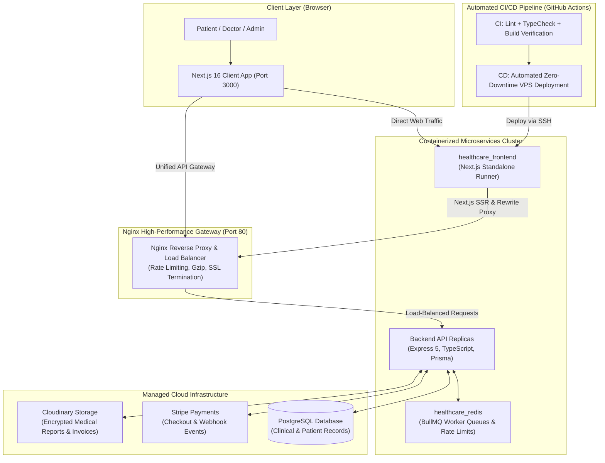
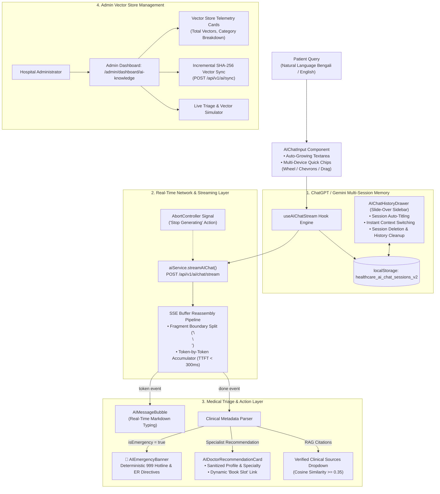
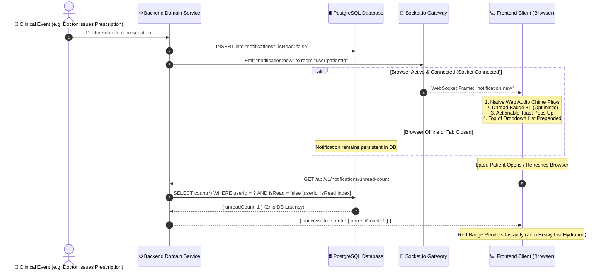

# 🏥 HealthCare — Enterprise Telehealth & Clinical Consultation Platform

<p align="center">
  
  
  
  
  
  
  
  
  
  
  
  
  
</p>

---

## 📌 Executive Summary

**HealthCare** is an enterprise-grade digital health and clinical consultation web platform designed to support millions of patients, board-certified doctors, and hospital administrators. Built with **Next.js 16 (App Router)** and **React 19**, the platform unites specialist discovery, real-time schedule locking, dual-track payment systems (Stripe + Automated Pay Later with live expiration countdown), secure Cloudinary PDF invoice delivery, and end-to-end encrypted telehealth records.

Engineered with high-availability cloud standards, the frontend features **Next.js Standalone Containerization** (reducing image size down to **87 MB**), a unified **Nginx Single Gateway Reverse Proxy**, full **GitHub Actions CI/CD Automation**, and dedicated **Admin Observability & BullMQ Queue Monitoring**.

---

## 🏗️ System Architecture & Data Flow



---

## 🚀 Automated CI/CD Pipeline (GitHub Actions)

The repository implements a robust, continuous integration and continuous deployment (CI/CD) lifecycle configured via **GitHub Actions**:

### 1. Continuous Integration (`.github/workflows/ci.yml`)
- **Triggers:** Every push to `main`, `dev`, or `feature/**` branches, and on Pull Requests targeting `main` or `dev`.
- **Concurrency Control:** Cancels superseded in-progress builds to conserve runner compute minutes.
- **Automated Quality Checks:**
  1. **Clean Installation:** `npm ci --legacy-peer-deps` using automated Node.js v20 npm caching.
  2. **ESLint Code Quality Audit:** Validates clean syntax, React Compiler standards, and Next.js best practices (`npm run lint`).
  3. **Strict Type-Checking:** Runs `npx tsc --noEmit` across all 48 App Router routes and modules to prevent runtime type errors.
  4. **Standalone Production Build Verification:** Executes `npm run build` with mock gateway variables to guarantee zero build breakages.

### 2. Continuous Deployment (`.github/workflows/deploy.yml`)
- **Triggers:** Automatically on push to `main` branch (or manual dispatch).
- **Execution Workflow:**
  1. Secure authentication via encrypted SSH (`appleboy/ssh-action@v1.0.3`) into the production Linux VPS.
  2. Executes repository sync (`git pull origin main`).
  3. Rebuilds and launches the Next.js standalone container (`docker compose up -d --build --remove-orphans`).
  4. Automatic garbage collection of dangling layers (`docker image prune -f`) to maintain lean server storage.

---

## 🤖 Enterprise Applied AI & Clinical RAG Frontend Architecture

Our frontend features a clinical-grade **AI Health Assistant & Medical Triage Interface** built on real-time **Server-Sent Events (SSE) streaming**, **ChatGPT / Gemini-style multi-session history**, and **Retrieval-Augmented Generation (RAG)** visualization. It bridges patients directly to board-certified hospital specialists while enforcing deterministic medical safety guardrails.



### 🧠 Core Frontend AI Engineering Pillars

#### 1. Real-Time SSE Token-by-Token Streaming with Defragmentation Buffer
- **The Problem:** Traditional single-payload REST APIs force patients to stare at a loading spinner for 3 to 6 seconds before seeing any response. Furthermore, standard HTTP chunks can fragment JSON payloads across packet boundaries (e.g., `data: {"text": "par` in chunk 1 and `tial"}` in chunk 2), causing naive `JSON.parse` logic to crash.
- **Our Solution:** A custom chunk reassembly engine in `aiService.streamAIChat()`:
  - Consumes incoming chunks via `response.body.getReader()` and `TextDecoder("utf-8")`.
  - Buffers and splits chunks on double-newline SSE boundaries (`\n\n`), keeping trailing partial fragments in memory until the next chunk arrives.
  - Emits real-time tokens with a **Time-To-First-Token (TTFT) under 300ms**.
- **Stream Abortion (Stop Generating):** Integrated with an `AbortController`. When the user clicks "Stop", the controller triggers `reader.cancel()` immediately, terminating frontend state updates and closing the network stream.

#### 2. ChatGPT, Gemini & Claude Style Multi-Session Conversation History
- **Slide-Over History Drawer (`AIChatHistoryDrawer.tsx`):** A slide-over glassmorphic panel accessible via the hamburger menu icon in the chat header.
- **Auto-Session Titling:** New consultation sessions are dynamically titled using the patient's first clinical query (e.g., *"আমার হাঁটুতে অনেক ব্যথা..."*), just like ChatGPT and Gemini.
- **Complete Session Lifecycle:**
  - `+ New Consultation`: Spawns a fresh session with an initialized clinical greeting.
  - Seamless session switching: Restores past conversation messages and doctor recommendations in $O(1)$ time.
  - Individual session deletion (`Trash2`) and complete history wipe (`Clear all`).
  - **Local Persistence:** Preserves session histories in `localStorage` across page reloads and browser sessions.

#### 3. Deterministic Clinical Emergency Triage & Rule-0 Visualization
- **Acute Emergency Highlighting (`AIEmergencyBanner.tsx`):** When the backend's deterministic regex engine flags a life-threatening symptom (e.g., myocardial infarction, severe dyspnea, acute stroke), the UI renders an animated crimson emergency beacon.
- **Direct 999 Hotline Action:** Overrides standard appointment booking with an immediate action button dialing Bangladesh Emergency Services (`tel:999`) and directs the patient to the nearest emergency room.

#### 4. Board-Certified Doctor Recommendations & Direct Booking Integration
- **Sanitized Doctor Cards (`AIDoctorRecommendationCard.tsx`):** Replaces raw backend text with clean specialist cards displaying avatar fallback initials, consultation fees, and formatted specialties (cleaning database indices like `neurology -1` into clean labels).
- **Direct Booking Link:** Seamlessly binds recommendation cards to the doctor's booking route (`/doctors/[id]`), allowing patients to reserve a slot within seconds of AI triage.
- **Verified Clinical RAG Citations:** Collapsible accordion listing verified database sources (Doctors, Specialties, Policies) matching the query with cosine similarity scores ($\ge 0.35$).

#### 5. Multi-Device Accessible Quick Ask Chips (Desktop Wheel, Chevrons & Drag)
- **Desktop Mouse Wheel Translation:** Solves the classic browser bug where vertical mouse wheels (`deltaY`) fail to scroll horizontal `overflow-x` containers by translating vertical scroll inputs into horizontal offset shifts.
- **Floating Navigation Chevrons (`<` & `>`):** Rendered dynamically when chips overflow the viewport, allowing one-click scrolling.
- **Mouse Drag-to-Scroll:** Enables click-and-drag horizontal swiping on desktop alongside native touch swiping on mobile.

#### 6. Admin AI Vector Knowledge Base & Telemetry Dashboard (`/admin/dashboard/ai-knowledge`)
- **Direct Admin Navigation:** Integrated into the Admin Sidebar under `System & Monitoring`.
- **Live Vector Store Telemetry:** Visualizes total indexed vectors, doctor document counts, specialty tags, and pgvector cosine distance health metrics (`GET /api/v1/ai/stats`).
- **One-Click Incremental Sync:** Trigger button for `POST /api/v1/ai/sync` with loading spinners and status toasts.
- **Live Triage & Vector Simulator:** Interactive administrative sandbox allowing staff to test Bengali or English symptom queries and preview vector matching in real-time.

---

## 🎥 Real-Time Telemedicine Messaging & WebRTC Live P2P Consultation Architecture

Our platform provides an enterprise **Split Consultation Room (`/consultation/[appointmentId]`)** integrating **WebRTC Peer-to-Peer Encrypted HD Video/Voice Calling** with a **WhatsApp / Messenger UX Real-Time Chat Engine** powered by Socket.io.

```mermaid
sequenceDiagram
    autonumber
    actor Doctor as Doctor Client
    participant Signaling as Socket.io Server (Signaling Gateway)
    actor Patient as Patient Client
    participant Cloud as Cloudinary Storage

    Note over Doctor,Patient: 1. Room Handshake & Presence Setup
    Doctor->>Signaling: join:appointment { appointmentId }
    Patient->>Signaling: join:appointment { appointmentId }
    Signaling-->>Doctor: participant:online { userId, role }
    Signaling-->>Patient: participant:online { userId, role }

    Note over Doctor,Patient: 2. Real-Time Chat Engine (WhatsApp / Messenger UX)
    Patient->>Signaling: chat:typing { isTyping: true }
    Signaling-->>Doctor: chat:user-typing { isTyping: true }
    Patient->>Cloud: POST /api/v1/chat/:id/attachment (Lab Report PDF)
    Cloud-->>Patient: { url, mimetype, size }
    Patient->>Signaling: chat:send { content, attachmentUrl, tempId }
    Signaling-->>Doctor: chat:new { message }
    Signaling-->>Patient: chat:new { message (status: DELIVERED) }
    Doctor->>Signaling: chat:read { appointmentId }
    Signaling-->>Patient: chat:messages-read (Double Blue Ticks)

    Note over Doctor,Patient: 3. WebRTC P2P Voice & Video Call Handshake
    Doctor->>Signaling: call:initiate { appointmentId, videoCallingId, callType }
    Signaling-->>Patient: call:incoming { callId, callerName, callType }
    Note over Patient: Native Web Audio Synthesizer Plays Ringtone
    Patient->>Signaling: call:accept { appointmentId, callId }
    Signaling-->>Doctor: call:accepted { callId }
    Doctor->>Signaling: webrtc:offer { sdp }
    Signaling-->>Patient: webrtc:offer { sdp }
    Patient->>Signaling: webrtc:answer { sdp }
    Signaling-->>Doctor: webrtc:answer { sdp }
    Doctor->>Signaling: webrtc:ice-candidate { candidate }
    Signaling-->>Patient: webrtc:ice-candidate { candidate }

    Note over Doctor,Patient: Direct Encrypted P2P Media Streams (Video, Mic, Screen Share)
    Doctor<-->>Patient: Direct P2P Media Stream (SRTP / DTLS)

    Note over Doctor,Patient: 4. Call Termination & Audit Trail
    Doctor->>Signaling: call:end { appointmentId }
    Signaling-->>Patient: call:ended { durationSec }
    Note over Doctor,Patient: Audio Beep Plays & Hardware Tracks Stopped
```

### 🧠 Core Telehealth Engineering Pillars

#### 1. WebRTC Signaling with Race-Condition Free ICE Candidate Queuing
- **The Problem:** In WebRTC, ICE candidates often arrive at the client *before* the asynchronous `setRemoteDescription` call resolves. Calling `addIceCandidate()` prematurely throws an `InvalidStateError` and drops the media handshake for up to 40% of calls.
- **Our Solution:** `useWebRtc` implements a deterministic candidate queue (`queuedCandidatesRef`). Out-of-order candidates arriving before remote description completion are buffered safely. Once `setRemoteDescription` successfully resolves, the buffer is flushed and candidates are injected sequentially.
- **Dual-STUN High Availability:** Dynamic STUN/TURN retrieval from `GET /api/v1/webrtc/ice-servers` with fallback to Google's public STUN pool (`stun.l.google.com:19302`), ensuring connections cross NAT/firewalls seamlessly.

#### 2. WhatsApp / Messenger Real-Time Chat UX
- **Optimistic UI Delivery:** Messages appear immediately with a `SENDING` clock icon, transitioning to a single tick upon server receipt and double gray ticks upon delivery.
- **Double Blue Ticks (`chat:messages-read`):** Automatically emits read receipts when the chat viewport is focused, updating sent messages with WhatsApp-style double blue checks.
- **Debounced Typing Indicator (`chat:user-typing`):** Throttled at 1200ms intervals with auto-expiring 3-second timers to prevent socket congestion.
- **Live Message Editing & Unsend:** Senders can edit existing messages in-place with an `(edited)` tag or unsend them with real-time propagation across all participant screens.

#### 3. Clinical Screen Sharing & Movable Picture-in-Picture (PiP)
- **Clinical Screen Sharing:** Enables physicians to share lab test reports, radiology scans, or prescription notes directly via `navigator.mediaDevices.getDisplayMedia({ video: true })` using real-time WebRTC track replacement (`sender.replaceTrack`). Automatically reverts to camera upon user cancellation.
- **Movable Picture-in-Picture (PiP):** Compact, expandable self-view camera preview in the bottom-right corner with mirror flip and track status overlays.

#### 4. Web Audio API Zero-Latency Sound Synthesizer
- **Zero Asset Dependency:** Rather than relying on external `.mp3` or `.wav` files that risk 404 network errors or browser blocking, `soundAlerts` synthesizes crisp frequencies in real time using the browser's native `AudioContext`:
  - **Incoming Message Chime:** 2-tone melodic harmonic cadence (E6 $\to$ G6).
  - **Incoming Call Ringtone:** Periodic 4-tone ascending ringtone sequence (C5 $\to$ E5 $\to$ G5 $\to$ C6).
  - **Call Termination Tone:** Soft descending ending cadence (G5 $\to$ C5).

#### 5. Cloudinary Multi-Format Attachment Pipeline & Voice Notes
- Supports seamless clinical document exchange (PDF diagnostic reports, high-res medical imagery, voice notes).
- Enforces strict client-side file size guardrails ($\le 10\text{ MB}$) before uploading via `chatService.uploadChatAttachment()`.
- Built-in lightbox modal for high-resolution image viewing.
- **Voice Note Engine with Real-Time Waveform Equalizer (`ActiveRecordingBar.tsx`):**
  - Live 4-bar dynamic audio amplitude visualizer driven by native Web Audio API `AudioContext` & `AnalyserNode`.
  - **Intelligent Hardware Mic Detection:** Auto-enumerates audio devices and prioritizes physical hardware microphones over silent/disconnected virtual drivers (e.g. `e2eSoft iVCam`, `Camo`).
  - **Universal Cross-Browser Playback (`VoiceNotePlayer.tsx`):** Streams Cloudinary transcoded `.mp3` for immediate duration parsing, scrub seeking, and iOS/Safari/Chrome compatibility with raw `.webm` fallback.

#### 6. Device Permission Recovery & Responsive Consultation Layout
- **Permission Denial Shield (`MediaPermissionModal.tsx`):** Detects browser `NotAllowedError` or missing hardware exceptions and provides step-by-step instructions on enabling camera/mic permissions.
- **Responsive Split Room:** On desktop, offers a 65/35 split between the video window and real-time chat. On mobile/tablet, offers an interactive tab switch with unread message counters.

---

## 🔔 Enterprise Real-Time Hybrid Notification System (HTTP REST + WebSockets)

Our platform implements a **Mission-Critical Hybrid Notification Architecture** combining pure **WebSockets (Socket.io with Redis Adapter)** for sub-10ms ephemeral alerts with **Composite-Indexed HTTP REST Endpoints** on PostgreSQL for high-efficiency pagination, unread badge hydration, and persistent state management.



### 🧠 Core Notification Engineering Pillars

#### 1. Why The Hybrid Architecture? (The Senior Architectural Rationale)
- **Why WebSockets Alone Are Insufficient:** If a patient is offline, asleep, or navigating between tabs, pure socket messages vanish into thin air. Relying solely on WebSockets leads to permanent notification loss upon browser reloads.
- **Why Polling Alone Fails at Scale:** Polling `GET /notifications` every 5 seconds across 100,000 active users generates **1.2 million HTTP requests per minute**, thrashing database connection pools and melting API gateway CPU cores.
- **The Senior Solution:**
  - **WebSocket Channel (Latency < 10ms):** Dedicated to instantaneous live delivery, synthesized audio chimes, optimistic badge incrementing, and urgent in-consultation alerts.
  - **HTTP REST Channel (Lazy-Loaded):** Dedicated to initial badge hydration (`/unread-count`), user-initiated infinite scrolling, and preference mutations.

#### 2. Composite-Indexed `/unread-count` vs. Naive Full-List Hydration
- **The Common Junior Anti-Pattern:** Fetching the entire notification list (containing heavy text, metadata, and routing links) on every page load just to extract `.length` for a red navbar dot.
- **Our Senior Implementation:** 
  - The Navbar calls `GET /api/v1/notifications/unread-count` on mount.
  - Hits a database composite index `[userId, isRead]` and executes `SELECT count(*) WHERE userId = ? AND isRead = false` in **under 2 milliseconds**.
  - Returns a tiny payload `{ unreadCount: 3 }`, saving megabytes of bandwidth and eliminating main-thread rendering lag.
  - **Lazy-Loaded Dropdown:** The actual notifications list (`GET /api/v1/notifications?page=1&limit=10`) is only fetched when the patient clicks the Bell icon (`NotificationBell.tsx`), preserving sub-100ms Initial Page Loads.

#### 3. Smart In-Room Route Suppression Engine
- **The Problem:** When both doctor and patient are actively in video consultation at `/consultation/[appointmentId]`, having a full-screen toast pop up saying *"Doctor has entered the consultation room and is waiting for you! [Join Now]"* is confusing, redundant, and disrupts clinical focus.
- **Our Solution (`useNotifications.ts`):** 
  - Intercepts incoming `notification:live` frames (`PEER_WAITING_IN_ROOM` and `CONSULTATION_JOIN`).
  - Evaluates current `pathname` against the payload `link` and `metadata.appointmentId`.
  - If the user is actively inside the room (`pathname === payload.link || pathname.startsWith(payload.link)`), the toast alert is automatically suppressed while maintaining internal presence indicators.
  - If the user is on the dashboard or another page, it triggers an urgent dual-tone sound alert and displays an actionable banner with a direct **`[Join Now]`** button.

#### 4. Triple-Variant Actionable Card Design System (`NotificationItem.tsx`)
Rather than rendering monotonous text blocks, notifications are classified into 3 distinct visual variants based on urgency and metadata:
1. **Waiting Room Arrival (`PEER_WAITING_IN_ROOM` / `CONSULTATION_JOIN`):**
   - High-contrast emerald card (`border-l-4 border-emerald-500 bg-emerald-50/50`).
   - Animated pulsing beacon (`animate-ping` dot).
   - Direct CTA button: **`[Join Room]`** routing directly to the video consultation session.
2. **5-Minute Urgent Countdown (`APPOINTMENT_REMINDER`):**
   - Amber warning card with `"5m Final Call"` badge and clock indicator.
   - Quick **`[Enter Room]`** action button.
3. **Standard Clinical Notifications:**
   - Color-coded Lucide badges: `FileText` (Prescription), `Calendar` (Booking), `CreditCard` (Payment), `MessageSquare` (Chat Ping), and `ShieldAlert` (Security Alert).
   - Clickable row with relative timestamping (`date-fns`) and optimistic hover deletion (`Trash2`).

#### 5. Dual-Tone Zero-Asset Audio Synthesizer (`soundAlerts.ts`)
Synthesizes crisp frequencies in real time using the browser's native `AudioContext` without loading external audio assets:
- `soundAlerts.playNotificationChime()`: 3-tone ascending melodic triad (F5 $\to$ A5 $\to$ C6) for prescriptions, bookings, and chat messages.
- `soundAlerts.playUrgentAlertChime()`: High-frequency dual-tone ascending double beep (C6 $\to$ E6) for appointment countdowns and waiting room arrivals.

#### 6. Immediate Security Enforcement & Auto-Reconnect Reconciliation
- **Immediate Account Revocation (`user:blocked`):** When an administrator disables an account, the socket gateway broadcasts `user:blocked`. The client displays a security modal with the admin's ban reason, purges `localStorage` auth tokens and cookies, and forces an immediate redirect to `/login?error=blocked`.
- **Automatic Reconnection Reconciliation:** Listens to socket `connect` events to instantly re-fetch `GET /unread-count`, automatically synchronizing any alerts missed during momentary Wi-Fi disconnects or laptop sleep cycles.
- **Granular Notification Preferences (`/preferences`):** Complete user-controlled settings modal (`NotificationPreferencesModal.tsx`) allowing users to toggle Sound Alerts, In-App Badges, Email Notifications, and Appointment Reminders.

---

## ✨ Core Features & Architectural Highlights

### 1. 🌟 High-Conversion Clinical Landing Page
- **Interactive Specialist Search Bar:** Embedded search with real-time specialty filtering and auto-suggestion directly linked to `/doctors`.
- **Dynamic Clinical Departments:** Dynamic data-fetching of medical departments (Cardiology, Neurology, Pediatrics, Orthopedics, Ophthalmology, etc.).
- **Live Doctor Showcase:** Server-rendered doctor cards featuring verified credentials, designation, hospital affiliation, consultation fee, and direct booking CTA.
- **Modern Bento Grid Ecosystem:** Showcases encrypted video telemedicine, cloud e-prescriptions, Stripe checkout, and zero-conflict schedule locking.

### 2. 📅 Zero-Conflict Doctor Scheduling & Booking Engine
- **Slot Reservation Algorithm:** Transactional slot locking prevents double booking and schedule collision.
- **Timezone & Running Date Normalization:** Automatically filters out historical/passed schedule slots to reduce client-side payload and eliminate database load.
- **Smart Appointment Tracking:** Immediate feedback with full booking review modal, doctor summary, and calendar integration.

### 3. 💳 Intelligent Dual-Payment Architecture
- **Stripe Card Checkout:** Seamless integration with Stripe hosted checkout and asynchronous webhook event synchronization.
- **Automated Pay-Later Reservation with Real-Time Expiry:**
  - Patients can reserve their slot instantly without immediate payment.
  - **30-Minute Live Countdown Component (`PayLaterCountdown.tsx`):** Displays real-time remaining minutes and seconds.
  - **Urgent 5-Minute Warning State:** At $\le 5$ minutes, switches into an animated pulsing alert beacon (`⚠️ Hurry! Pay before auto-cancel`).
  - **Auto-Expiration Protection:** Expired bookings automatically deactivate the "Pay Online" button to avoid conflict and keep slot availability clean.
- **Official PDF Invoice Delivery:** Generates PDF invoices stored securely in Cloudinary with dedicated delivery permissions and browser preview.

### 4. 🛡️ Admin Telemetry & Real-Time Monitoring Ecosystem
- **Request Logs & HTTP Telemetry (`/admin/dashboard/request-logs`):**
  - High-throughput audit buffer tracking request path, HTTP method badge, response status codes, latencies, IP addresses, and user-agent devices.
  - Role-based user tracking: Displays authenticated user role badges (`SUPER_ADMIN`, `ADMIN`) and user IDs alongside anonymous public traffic.
  - Fast search, method/status code filtering, and instant audit log cleanup.
- **Background Job Queues Dashboard (`/admin/dashboard/queues`):**
  - Embedded **BullMQ & Bull-Board** visual monitoring dashboard.
  - Real-time visibility into active workers: Email Notification Queue, Stripe Webhook Processing, and Schedule Auto-Release Cron.
  - Same-origin reverse proxy (`next.config.ts` rewrites) eliminating CORS and `X-Frame-Options: SAMEORIGIN` restrictions while automatically relaying authorization cookies.

### 5. 📊 Patient & Doctor Clinical Portals
- **Server-Side Pagination (`AppPagination.tsx`):** Fast URL-driven search parameter pagination (`?page=1&limit=6`) with total records metadata counters.
- **Appointments Management:** Distinct status badges for `SCHEDULED`, `COMPLETED`, and `CANCELED` consultations.
- **Digital Health Records & Prescriptions:** Direct access to medical records, prescriptions, and official receipts.

### 6. 🔐 Role-Based Access Control (RBAC) & Next.js Middleware
- Strict multi-role protection (`PATIENT`, `DOCTOR`, `ADMIN`, `SUPER_ADMIN`).
- Next.js edge middleware inspecting HttpOnly JWT tokens, silent refresh-token rotation, and instant unauthenticated redirects.

---

## 🐳 DevOps, Docker & Containerization

The project utilizes a 4-stage multi-stage Docker build optimized for high-security enterprise environments:

| Stage | Image | Purpose |
| :--- | :--- | :--- |
| **1. Base** | `node:22-alpine` | Installs `libc6-compat` for Alpine Linux native binary compatibility |
| **2. Deps** | `node:22-alpine` | Caches package manifests and runs clean dependency installation (`npm ci --legacy-peer-deps`) |
| **3. Builder** | `node:22-alpine` | Executes `output: "standalone"` Next.js build with baked client environment variables & proxy targets |
| **4. Runner** | `node:22-alpine` | Non-root system user (`nextjs:nodejs`), minimal image size, sub-second boot time |

### 🚀 Image Optimization Result:
- **Default Image Size:** $\sim 1.5\text{ GB}$
- **Optimized Standalone Image Size:** **$87.3\text{ MB}$** ($\gt 94\%$ reduction)
- **Startup Time:** `Ready in 0ms`

---

## 🗺️ Product Roadmap & Upcoming Milestones

We are actively expanding this platform into a comprehensive AI-augmented healthcare network:

- [x] **🤖 AI Clinical Health Assistant & Real-Time Triage (Shipped)**
  - Full-stack clinical RAG integration with Google Gemini & PostgreSQL pgvector (768-D).
  - Sub-300ms Server-Sent Events (SSE) token streaming with AbortController cancellation.
  - ChatGPT / Gemini-style multi-session history with auto-titling and slide-over drawer (`AIChatHistoryDrawer`).
  - Deterministic Rule-0 acute emergency alerts with instant 999 dialing (`AIEmergencyBanner`).
  - Admin vector knowledge base telemetry & one-click incremental sync dashboard (`/admin/dashboard/ai-knowledge`).
- [x] **🎥 WebRTC HD Video & Audio Telehealth (Shipped)**
  - In-browser peer-to-peer encrypted HD video & crystal-clear voice consultation rooms.
  - Race-condition-free ICE candidate queuing (`queuedCandidatesRef`) and dual-STUN high availability.
  - High-resolution clinical screen sharing with zero-flicker native track replacement (`sender.replaceTrack`).
  - Movable Picture-in-Picture (PiP) self-view with hardware device permission recovery modal.
- [x] **💬 Real-Time In-Consultation Chat & Voice Notes (Shipped)**
  - Pure WebSocket / Socket.io real-time encrypted messaging with zero HTTP polling.
  - WhatsApp / Messenger UX: live debounced typing indicators, optimistic delivery, and double blue read receipts.
  - Voice Note Engine: dynamic 4-bar real-time audio waveform visualizer powered by Web Audio API (`AudioContext`).
  - Intelligent hardware microphone auto-detection bypassing disconnected virtual drivers (iVCam, Camo).
  - Progressive vocal recording with Cloudinary universal MP3 transcode playback.
  - Instant clinical PDF laboratory report and high-resolution diagnostic image sharing with 10MB guardrail.
- [x] **🔔 Real-Time Hybrid Notification System (HTTP + WebSockets) (Shipped)**
  - Dual-channel hybrid architecture: pure WebSockets (latency < 10ms) + composite-indexed REST (`[userId, isRead]`).
  - Smart in-room route suppression engine preventing redundant toast popups on active `/consultation/[id]` routes.
  - Triple-variant actionable cards: pulsing green waiting room alert with direct `[Join Room]` CTA, 5-minute urgent countdown, and standard clinical records.
  - Zero-latency native Web Audio API dual-tone sound synthesizer (melodic triad & urgent double beep).
  - Security immediate force logout (`user:blocked`) and automatic reconnect badge reconciliation.
  - Granular notification preferences matrix (sound, in-app, email, and appointment reminder opt-ins).
- [ ] **📑 OCR Prescription Parser & Diagnostic Lab Integration (Q3 2027)**
  - Computer-vision OCR to digitize handwritten doctor prescriptions and schedule automated medicine dosage reminders.
- [ ] **📲 Multi-Channel Notifications (WhatsApp & SMS) (Q3 2027)**
  - Automated Twilio / WhatsApp Business API notifications for appointment confirmations, 15-minute reminders, and invoice receipts.

---

## 🛠️ Technology Stack

| Category | Technology |
| :--- | :--- |
| **Framework** | [Next.js 16](https://nextjs.org/) (App Router, Server Components & Server Actions) |
| **Library** | [React 19](https://react.dev/) |
| **Language** | [TypeScript 5](https://www.typescriptlang.org/) |
| **Applied AI & RAG** | [Google Gemini](https://ai.google.dev/) API, Server-Sent Events (SSE), Vector Citations & Multi-Session Storage |
| **Styling** | [Tailwind CSS v4](https://tailwindcss.com/), `tw-animate-css`, Glassmorphism |
| **Component System**| [Radix UI](https://www.radix-ui.com/), [Shadcn UI](https://ui.shadcn.com/) |
| **Icons** | [Lucide React](https://lucide.dev/) |
| **Networking** | [Axios](https://axios-http.com/) & Native Fetch with dual-network SSR/CSR resolution |
| **Monitoring & Queues**| [Bull-Board](https://github.com/felixmosh/bull-board) (BullMQ Visual UI), Real-time HTTP Telemetry |
| **DevOps & CI/CD** | [Docker](https://www.docker.com/) (Standalone), [GitHub Actions](https://github.com/features/actions) |
| **Reverse Proxy** | [Nginx](https://nginx.org/) Unified Single Gateway |
| **Payments** | [Stripe](https://stripe.com/) Checkout SDK |
| **Storage & Assets** | [Cloudinary](https://cloudinary.com/) (Certified Secure Raw PDF & Image Delivery) |

---

## ⚙️ Environment Configuration
 
Configure your local environment by creating a `.env` file based on the template:

```bash
cp .env.example .env
```

Add your service endpoints:

```env
# Client-Facing Public API Gateway (Accessible from User's Browser)
NEXT_PUBLIC_API_BASE_URL=your_end_points
NEXT_PUBLIC_API_URL=your_end_points


# Internal Docker Network Service URL (For Server-Side Rendering within Docker Network)
INTERNAL_API_BASE_URL=your_end_points
```

---

## 🚀 Getting Started

### Option 1: Running with Docker Compose (Recommended)

Make sure Docker Desktop is running, then run:

```bash
# Build and launch the container in the background
docker compose up -d --build

# View container logs
docker compose logs -f

# Stop container
docker compose down
```

Access the application at **`http://localhost:3000`** (or through the Nginx gateway at **`http://localhost`**).

### Option 2: Running Locally

```bash
# 1. Install dependencies
npm install --legacy-peer-deps

# 2. Run development server
npm run dev

# 3. Production build & start
npm run build
npm run start
```

---

## 👨‍💻 Engineering & Maintainer

**Developed by:** Alif Hossin Sajjad  
- **GitHub:** [@alifhossinsajjad](https://github.com/alifhossinsajjad)  
- **Platform:** HealthCare Services Ltd.  
- **Focus:** Enterprise Full-Stack Web Development, Telehealth Engineering & Distributed Microservices.

---

<p align="center">
  <sub>Built with clinical precision and modern web architecture. Available under the MIT License.</sub>
</p>
